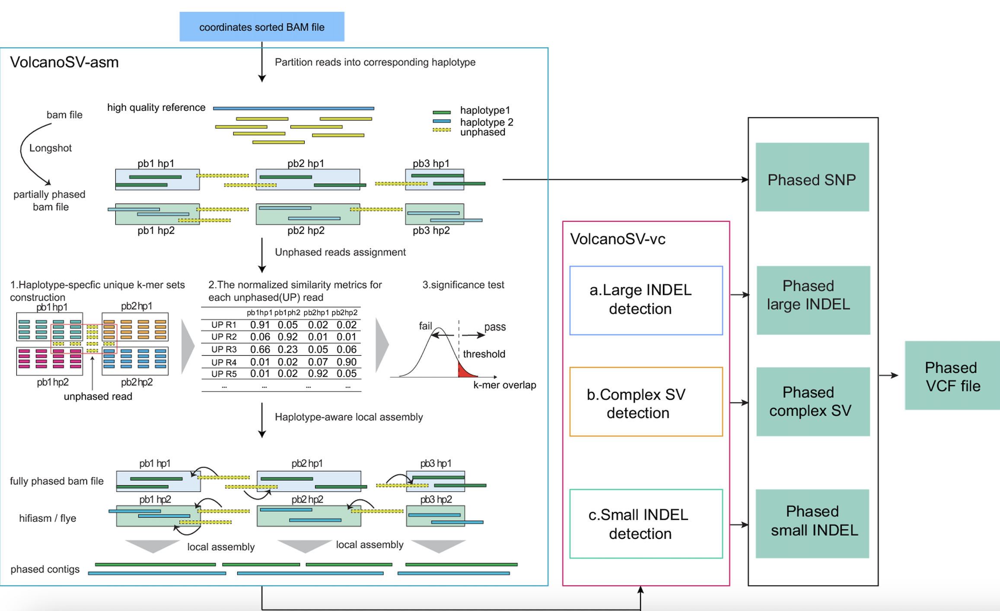

# :milky_way: VolcanoSV 🌋
VolcanoSV is an innovative hybrid SV detection pipeline that utilizes both a reference genome and local de novo assembly to generate a phased diploid assembly. 


## Table of Content 
- [Installation](#install-through-github)
- [Before you start](#before-you-start)
- [Single chromosome mode (test example included)](#single-chromosome-mode)
    - [Single chromosome mode VolcanoSV Assembly](#Single-chromosome-mode-VolcanoSV-Assembly-volcanosv-asm)
    - [Single chromosome mode VolcanoSV Assembly (Single assembler)](#Single-chromosome-mode-VolcanoSV-Assembly-Single-assembler)
    - [Single chromosome mode VolcanoSV Assembly (hybrid mode)](#Single-chromosome-mode-VolcanoSV-Assembly-hybrid-mode)
    - [Single chromosome mode Large Indel detection](#Single-chromosome-mode-Large-Indel-detection-volcanosv-vc)
    - [Single chromosome mode Small Indel detection](#Single-chromosome-mode-Small-Indel-detection-volcanosv-vc)
    - [Single chromosome mode SNP detection](#Single-chromosome-mode-SNP-detection-volcanosv-vc)
- [WGS mode](#wgs-mode)
  -  [WGS mode VolcanoSV Assembly](#wgs-mode-VolcanoSV-Assembly-volcanosv-asm)
  -  [WGS mode Large Indel detection](#wgs-mode-Large-Indel-detection-volcanosv-vc)
  -  [WGS mode Complex SV detection](#wgs-mode-complex-sv-detection-volcanosv-vc)
  -  [WGS mode Small Indel detection](#wgs-mode-small-Indel-detection-volcanosv-vc)
  -  [WGS mode SNP detection](#wgs-mode-SNP-detection-volcanosv-vc)
- [Merge VCF](#Merge-VCF)
- [Use VolcanoSV-vc for other assemblies](#Use-VolcanoSV-vc-for-other-assemblies)
- [Improve assembly for regions enriched in segmental duplications](#Optional-Improve-assembly-for-regions-enriched-in-segmental-duplications-SDs)
- [Truvari evaluation](#Truvari-evaluation)
- [Computation resource usage](#Computation-resource-usage)
- [Citation](#cite-volcanosv)
- [Troubleshooting](#Troubleshooting)
  
# Install through Github:

```
git clone --recurse-submodules https://github.com/maiziezhoulab/VolcanoSV.git
cd VolcanoSV;sh Install.sh
```

## Dependencies for Github installation:
VolcanoSV utilizes **Python3.8.3** To set up the environment, you need to have conda installed. Then, simply run
```
conda env create -f VolcanoSV/requirement.yaml
```

Then you will have a virtual environment called **`volcanosv`** created. **Before running any VolcanoSV commands, please activate this environment first**.
```
conda activate volcanosv
```

<!-- Add VolcanoSV to `PATH` by
```
path_to_volcanosv=/path/to/VolcanoSV
PATH+=":${path_to_volcanosv}/bin/VolcanoSV-asm"
for i in ${path_to_volcanosv}/bin/VolcanoSV-vc/*/; do PATH+=":$i"; done
chmod +x ${path_to_volcanosv}/bin/VolcanoSV-asm/volcanosv-asm.py ${path_to_volcanosv}/bin/VolcanoSV-vc/Large_INDEL/volcanosv-vc-large-indel.py ${path_to_volcanosv}/bin/VolcanoSV-vc/Small_INDEL/volcanosv-vc-small-indel.py ${path_to_volcanosv}/bin/VolcanoSV-vc/Complex_SV/volcanosv-vc-complex-sv.py
```
You can also add the line above to `~/.bashrc` if you don't want to do it every time you start a shell -->
<!-- Next, put the "VolcanoSV/bin" in the ".bashrc" file, and source the ".bashrc" file <br /> -->

You can set
```
path_to_volcanosv=/path/to/VolcanoSV
```
for convenience or just use the full path of `${path_to_volcanosv}/bin/VolcanoSV-asm/volcanosv-asm.py`, `${path_to_volcanosv}/bin/VolcanoSV-vc/Large_INDEL/volcanosv-vc-large-indel.py`, `${path_to_volcanosv}/bin/VolcanoSV-vc/Complex_SV/volcanosv-vc-complex-sv.py` and `${path_to_volcanosv}/bin/VolcanoSV-vc/Small_Indel/volcanosv-vc-small-indel.py`.

**Note: To ensure you have installed VolcanoSV successfully, we highly recommend trying the tool on the provided [test data](https://zenodo.org/records/10520476) and checking whether you have the correct result before trying it on your data. For the guide on how to run the pipeline, please refer to [Single chromosome mode (test example included)](#single-chromosome-mode).**

# Running The Code:

## Before you start

**1.VolcanoSV is designed only for autosome chromosomes since the phasing procedure for sex chromosomes is very different!**

**2.Your reference FASTA can use any contig naming convention (e.g. `chr1`, `1`, `NC_000001.11`) as long as the same names are used consistently across your reference and BAM file(s) — VolcanoSV no longer assumes a "chr1, chr2, ... chr22" naming scheme. Whenever a pipeline step needs to know the full set of chromosomes/contigs to process (WGS mode), you must supply a `--chrom_list`/`-cl` (or `-chl`) text file listing one chromosome/contig name per line, exactly as they appear in your reference. In single-chromosome mode, `--chrom_list` should just contain that one name.**

**3.We highly recommend you to run the test data first before using VolcanoSV on your own data!**

## Single chromosome mode

For the single chromosome mode, we provided the chr10 BAM file, contigs file and VCF file for Hifi, CLR and ONT data. You can download them from [zenodo](https://zenodo.org/records/10520476).


In the following sessions, we will provide the code to run the Hifi data. **If you wish to reproduce the result for CLR data or ONT data, you can just simply change the input BAM file and the argument "dtype" to the corresponding data type (CLR/ONT)**.

The example data is aligned to hg19 reference. You can download the reference files(genome.fa and genome.fa.fai) from zenode(https://zenodo.org/records/10520476).

Alternatively, you can download the more complete reference data (including more indexing and meta data) using the command below
```
wget https://cf.10xgenomics.com/supp/genome/refdata-hg19-2.1.0.tar.gz
tar -xzvf refdata-hg19-2.1.0.tar.gz
```

**Note: since translocation detection requires WGS BAM file as support, it does not make sense to run it on single chromosome level. Therefore, we only provide the complex SV pipeline in WGS mode.**

### Single chromosome mode VolcanoSV Assembly (VolcanoSV-asm) 

#### Single chromosome mode VolcanoSV Assembly (Single assembler)
The VolcanoSV assembly pipeline is designed to run by chromosomes. **We integrated multiple state-of-the-art assemblers into the pipeline, including [hifiasm](https://github.com/chhylp123/hifiasm),[Flye](https://github.com/fenderglass/Flye),[wtdbg2](https://github.com/ruanjue/wtdbg2),[miniasm](https://github.com/lh3/miniasm),[Shasta](https://github.com/paoloshasta/shasta),[NextDenovo](https://github.com/Nextomics/NextDenovo),and [Hicanu/Canu](https://github.com/marbl/canu). Users can select the appropriate assembler based on their needs.** The main script is `${path_to_volcanosv}/bin/VolcanoSV-asm/volcanosv-asm.py`. The input arguments for this script are explained below:

```
  --bam_file INBAM, -bam INBAM, could be either wgs bam or single-chromosome bam file
  --output_dir output_dir, -o output_dir
  --reference REFERENCE, -ref REFERENCE
  --n_thread N_THREAD, -t N_THREAD
  --chrnum CHROM_NAME, -chr CHROM_NAME
                        chromosome/contig name to process, exactly as it appears in the reference and BAM (e.g. chr10, or NC_000010.11)
  --assembler {wtdbg2,canu,miniasm,shasta,nextdenovo,hifiasm,hicanu,flye}, -asm {wtdbg2,canu,miniasm,shasta,nextdenovo,hifiasm,hicanu,flye}
        optional; if not set, VolcanoSV use hifiasm for Hifi data and flye for CLR and ONT data by default.
  --data_type {CLR,ONT,Hifi}, -dtype {CLR,ONT,Hifi}
  --pacbio_subtype {rs,sq}, -pb {rs,sq}
                        must provide when using wtdbg2 on CLR data (default: None)
  --shasta_ont_config {Nanopore-OldGuppy-Sep2020}, -shacon {Nanopore-OldGuppy-Sep2020}
  --prefix PREFIX, -px PREFIX

```
**Please select from hifiasm and hicanu for Hifi data, and the rest of the assemblers are for CLR and ONT data.**
By default, VolcanoSV uses hifiasm for Hifi data and Flye for CLR and ONT data.
After running the above code, you will have output contigs in **`<ouput_folder>/<chrom_name>/assembly/final_contigs/<prefix>_final_contigs.fa`**, where `<chrom_name>` is whatever value you passed to `-chr`.

For example, if you want to use hifiasm for hifi data, you can use the below scripts

```
python3 ${path_to_volcanosv}/bin/VolcanoSV-asm/volcanosv-asm.py \
-bam Hifi_L2_hg19_minimap2_chr10.bam \
-o volcanosv_asm_output \
-ref refdata-hg19-2.1.0/fasta/genome.fa \
-t 10 \
-chr chr10 \
-dtype Hifi \
-px Hifi_L2 \
-asm hifiasm
```
The final contig will be **`volcanosv_asm_output/chr10/assembly/final_contigs/Hifi_L2_final_contigs.fa`**. 
If the volcanosv-asm pipeline is executed successfully, your final contig file should have roughly the same size as the **Hifi_L2_contigs.fa** from zenodo.
**VolcanoSV-asm already includes the executable version of all assemblers, so you do not need to install them individually.**
However, if you want more detailed information on these assemblers, you can [click here](Assemblers.md).
#### Single chromosome mode VolcanoSV Assembly (Hybrid mode)
Different assemblers vary in their ability to assemble regions enriched in segmental duplications (SDs) and other complex regions. Therefore, it is often advantageous to utilize different assemblers for different genomic regions. **We thus also provide a hybrid mode: users can input a BED file, and specify an "in-BED" assembler and an "out-BED" assembler. The phase blocks that overlap with the BED file will be assembled using the in-BED assembler, while the rest will be assembled by the out-BED assembler.** The script for this mode is `${path_to_volcanosv}/bin/VolcanoSV-asm/volcanosv-asm_hybrid.py`.

For example, if you provide a `segdups.bed`, and want to use hicanu for the segdup regions and hifiasm for the other rest regions, you can use the code below:

```
python3 ${path_to_volcanosv}/bin/VolcanoSV-asm/volcanosv-asm_hybrid.py \
-bam Hifi_L2_hg19_minimap2_chr10.bam \
-o volcanosv_asm_output \
-ref refdata-hg19-2.1.0/fasta/genome.fa \
-bed segdups.bed \
--inbed_assembler hicanu \
--outbed_assembler hifiasm \
-t 10 \
-chr chr10 \
-dtype Hifi \
-px Hifi_L2 
```
The final contig will be **`volcanosv_asm_output/chr10/assembly/final_contigs/Hifi_L2_final_contigs.fa`**. 
If the volcanosv-asm pipeline is executed successfully, your final contig file should have roughly the same size as the Hifi_L2_contigs.fa from zenodo.


### Single chromosome mode Large Indel detection (VolcanoSV-vc) 

The main code is `${path_to_volcanosv}/bin/VolcanoSV-vc/Large_INDEL/volcanosv-vc-large-indel.py`. The input arguments for this code are explained below:

```
  --input_dir INPUT_DIR, -i INPUT_DIR
  --output_dir OUTPUT_DIR, -o OUTPUT_DIR
  --data_type DATA_TYPE, -dtype DATA_TYPE
                        Hifi;CLR;ONT
  --bam_file RBAM_FILE, -bam RBAM_FILE
                        reads bam file for reads signature extraction
  --reference REFERENCE, -ref REFERENCE
                        wgs reference file
  --chrnum CHROM_NAME, -chr CHROM_NAME
                        chromosome/contig name (e.g. chr10, or NC_000010.11); optional; if not provided, will run in WGS mode over every chromosome in --chrom_list
  --chrom_list CHROM_LIST, -cl CHROM_LIST
                        (required) text file with one chromosome/contig name per line, matching the names in your reference FASTA. In single-chromosome mode it only needs to contain the one name passed to -chr; in WGS mode it should list every chromosome to process.
  --n_thread N_THREAD, -t N_THREAD
  --n_thread_align N_THREAD_ALIGN, -ta N_THREAD_ALIGN
  --mem_per_thread MEM_PER_THREAD, -mempt MEM_PER_THREAD
                        Set maximum memory per thread for alignment; suffix K/M/G recognized; default = 768M
  --prefix PREFIX, -px PREFIX

```
**The input directory should be the output directory of volcanoSV-asm**. This code is compatible with either single chromosome mode or wgs mode: **when the argument "chr" is provided, it will execute in single chromosome mode, otherwise, it will execute in wgs mode over every chromosome listed in `--chrom_list`. `--chrom_list` is always required. Please note that `prefix` should remain consistent with what is set in volcanosv-asm.**
After running the above code, you will have output VCF in **`<ouput_folder>/volcanosv_large_indel.vcf`**.

For example, if you want to reproduce the VCF file for large indels on Hifi_L2 data, you can use the following command:
```
echo chr10 > chrom_list.txt

python3 ${path_to_volcanosv}/bin/VolcanoSV-vc/Large_INDEL/volcanosv-vc-large-indel.py \
-i volcanosv_asm_output/ \
-o volcanosv_large_indel_output/ \
-dtype Hifi \
-bam Hifi_L2_hg19_minimap2_chr10.bam \
-ref refdata-hg19-2.1.0/fasta/genome.fa \
-chr chr10 -cl chrom_list.txt -t 10 \
-px Hifi_L2
```
The VCF file will be **`volcanosv_large_indel_output/chr10/Hifi_L2_volcanosv_large_indel_chr10.vcf`**. 
If the volcanosv-vc-large-indel pipeline is executed successfully, your VCF file should have roughly the same number of variants as the Hifi_L2_variants.vcf from zenodo.
**Note that, due to the randomness in assembly and alignment procedure, your VCF file may have 1 or 2 variants more or less than the Hifi_L2_variants.vcf. If that happens, we may still consider the pipeline as executed successfully, as long as the difference is minor.**


### Single chromosome mode Small Indel detection (VolcanoSV-vc) 

The main script is `${path_to_volcanosv}/bin/VolcanoSV-vc/Small_INDEL/volcanosv-vc-small-indel.py`. The input arguments for this script are explained below:


```
  --input_dir INPUT_DIR, -i INPUT_DIR
  --bam_file READ_BAM, -bam READ_BAM
  --output_dir OUTPUT_DIR, -o OUTPUT_DIR
  --reference REFERENCE, -ref REFERENCE
  --bedfile BEDFILE, -bed BEDFILE
                        optional; a high confidence bed file (default: None)
  --region REGION, -r REGION
                        optional; exmaple: chr21:2000000-2100000 (default: None)
  --chrom_list CHROM_LIST, -cl CHROM_LIST
                        (required) text file with one chromosome/contig name per line; only actually used when --region is not given, but the flag itself must always be provided
  --n_thread N_THREAD, -t N_THREAD
  --kmer_size KMER_SIZE, -k KMER_SIZE
  --ratio RATIO, -rt RATIO
                        maximum bad kmer ratio (default: 0.3)
  --min_support MIN_SUPPORT, -ms MIN_SUPPORT
                        maximum support for bad kmer (default: 5)
  --prefix PREFIX, -px PREFIX


```

**The input directory should be the output directory of volcanoSV-asm.**

The example code is as below:
```
echo chr10 > chrom_list.txt

python3 ${path_to_volcanosv}/bin/VolcanoSV-vc/Small_INDEL/volcanosv-vc-small-indel.py \
-i volcanosv_asm_output/ \
-o volcanosv_small_indel \
-bam Hifi_L2_hg19_minimap2_chr10.bam \
-ref refdata-hg19-2.1.0/fasta/genome.fa \
-r chr10 \
-cl chrom_list.txt \
-t 30 \
-px Hifi_L2
```
After running the above code, you will have output VCF in **`volcanosv_small_indel/Hifi_L2_volcanosv_small_indel.vcf`**.

### Single chromosome mode SNP detection (VolcanoSV-vc) 
We adopt Longshot's SNP call result as the final SNP call. After successfully running the assembly pipeline, you will have the phased SNP VCF file: `volcanosv_asm_output/<chromosome_name>/phasing_result/<prefix>_phased.vcf`.

## WGS mode

### WGS mode VolcanoSV Assembly (VolcanoSV-asm) 

The VolcanoSV assembly is designed to operate on a per-chromosome basis. **First, create a `chrom_list.txt` file listing every chromosome/contig name you want to process, one per line, exactly as they appear in your reference** (e.g. `chr1`, `chr2`, ... `chr22`, or whatever naming your reference uses) — this same file will also be needed later by the WGS-mode Large Indel/Small Indel/Complex SV steps.

If you have access to a distributed computing system that supports multiple job submissions, we recommend submitting one job per chromosome and running them concurrently. You can follow the template below to construct your job script:
```
python3 ${path_to_volcanosv}/bin/VolcanoSV-asm/volcanosv-asm.py \
-bam <wgs_bam> \
-o volcanosv_asm_output \
-ref <reference_file> \
-t 10 \
-chr <chromosome_name> \
-dtype <datatype> \
-px <prefix>
```
To create job scripts for different chromosomes, simply change the `<chromosome_name>` in each script (one value from your `chrom_list.txt` per job). All scripts share the same output folder. After all jobs are finished, you will see one subfolder per chromosome under the output folder you specified, named after each chromosome. This is the most efficient way to run volcanosv-asm pipeline on a distributed system.


However, if you do not have a distributed computing system, you may write a for loop to run different chromosomes:
```
while read -r chrom
do
echo "***********************assembly for ${chrom}*******************"
python3 ${path_to_volcanosv}/bin/VolcanoSV-asm/volcanosv-asm.py \
-bam <wgs_bam> \
-o volcanosv_asm_output \
-ref <reference_file> \
-t 10 \
-chr ${chrom} \
-dtype <datatype> \
-px <prefix>
done < chrom_list.txt
```
All chromosomes in `chrom_list.txt` will be saved under `volcanosv_asm_output`. This is slower but can still get the work done.


### WGS mode Large Indel detection (VolcanoSV-vc) 

The main script is `${path_to_volcanosv}/bin/VolcanoSV-vc/Large_INDEL/volcanosv-vc-large-indel.py`. This script is designed for both single chromosome mode and wgs mode. To run it in WGS mode, you should first finish running the volcanosv-asm pipeline and provide the assembly output folder as the input folder for this code. You should **not** provide the `chr` argument in WGS mode. **`--chrom_list`/`-cl` is always required — in WGS mode it must list every chromosome/contig to include (the same `chrom_list.txt` used for the assembly step works here).**

An example command is as below:
```
python3 ${path_to_volcanosv}/bin/VolcanoSV-vc/Large_INDEL/volcanosv-vc-large-indel.py \
-i volcanosv_asm_output/ \
-o volcanosv_large_indel_output/ \
-dtype <datatype> \
-bam <wgs_reads_bamfile> \
-ref <reference> \
-cl chrom_list.txt \
-t 11 \
-px <prefix>
```
After running the above code, you will have output VCF in **`volcanosv_large_indel_output/<prefix>_volcanosv_large_indel.vcf`**.


### WGS mode Complex SV detection (VolcanoSV-vc) 

The main code is `${path_to_volcanosv}/bin/VolcanoSV-vc/Complex_SV/volcanosv-vc-complex-sv.py`. The input arguments for this code are explained below:


```
  --input_dir INPUT_DIR, -i INPUT_DIR
  --indelvcf INDELVCF, -vcf INDELVCF
  --bamfile BAMFILE, -bam BAMFILE
  --reference REFERENCE, -ref REFERENCE
  --datatype {Hifi,CLR,ONT}, -dtype {Hifi,CLR,ONT}
  --output_dir output_dir, -o output_dir
  --chrom_list CHROM_LIST, -cl CHROM_LIST
                        (required) text file with one chromosome/contig name per line, matching the per-chromosome subfolder names under --input_dir
  --n_thread N_THREAD, -t N_THREAD
  --prefix PREFIX, -px PREFIX
```
The input directory should be the output directory of volcanoSV-asm.

The example code is as below:
```
python3 ${path_to_volcanosv}/bin/VolcanoSV-vc/Complex_SV/volcanosv-vc-complex-sv.py \
-i volcanosv_asm_output/ \
-vcf volcanosv_large_indel_output/volcanosv_large_indel.vcf \
-o volcanosv_complex_sv \
-dtype <datatype> \
-bam <wgs_reads_bamfile> \
-ref <reference> \
-cl chrom_list.txt \
-t 11 \
-px <prefix>
```
After running the above code, you will have output VCF in **`volcanosv_complex_sv/<prefix>_volcanosv_complex_SV.vcf`**.


### WGS mode Small Indel detection (VolcanoSV-vc) 

The main code is `${path_to_volcanosv}/bin/VolcanoSV-vc/Small_INDEL/volcanosv-vc-small-indel.py`. The input arguments for this code are explained below:


```
  --input_dir INPUT_DIR, -i INPUT_DIR
  --bam_file READ_BAM, -bam READ_BAM
  --output_dir OUTPUT_DIR, -o OUTPUT_DIR
  --reference REFERENCE, -ref REFERENCE
  --bedfile BEDFILE, -bed BEDFILE
                        optional; a high confidence bed file (default: None)
  --region REGION, -r REGION
                        optional; exmaple: chr21:2000000-2100000 (default: None)
  --chrom_list CHROM_LIST, -cl CHROM_LIST
                        (required) text file with one chromosome/contig name per line, matching the per-chromosome subfolder names under --input_dir
  --n_thread N_THREAD, -t N_THREAD
  --kmer_size KMER_SIZE, -k KMER_SIZE
  --ratio RATIO, -rt RATIO
                        maximum bad kmer ratio (default: 0.3)
  --min_support MIN_SUPPORT, -ms MIN_SUPPORT
                        maximum support for bad kmer (default: 5)
  --prefix PREFIX, -px PREFIX


```

The input directory should be the output directory of volcanoSV-asm.

The example code is as below:
```
python3 ${path_to_volcanosv}/bin/VolcanoSV-vc/Small_INDEL/volcanosv-vc-small-indel.py \
-i volcanosv_asm_output/ \
-o volcanosv_small_indel \
-bam <wgs_reads_bamfile> \
-ref <reference> \
-cl chrom_list.txt \
-t 30 \
-px <prefix>
```

After running the above code, you will have output VCF in **`volcanosv_small_indel/<prefix>_volcanosv_small_indel.vcf`**.

### WGS mode SNP detection (VolcanoSV-vc) 
We adopt Longshot's SNP call result as the final SNP call. After successfully running the assembly pipeline, you will have the phased SNP VCF file: `volcanosv_asm_output/<chromosome_name>/phasing_result/<prefix>_phased.vcf`.

## Merge VCF

After running the whole assembly-variant calling process, you may want to collect variants of all type and all chromosomes into one single VCF file. We provided script to do that.

If you run large and small indel detection in WGS mode, then you can do this
```
python3 ${path_to_volcanosv}/bin/Utils/Merge_VCF.py VolcanoSV_Variants.vcf \
volcanosv_large_indel_output/${prefix}_volcanosv_large_indel.vcf \
volcanosv_complex_sv/${prefix}_volcanosv_complex_SV.vcf \
volcanosv_small_indel/${prefix}_volcanosv_small_indel.vcf \
volcanosv_asm_output/*/phasing_result/${prefix}_phased.vcf
```

If you run large and small indel detection in single chromosome mode, and the result is in a format like `volcanosv_large_indel_output/<chromosome_name>/${prefix}_volcanosv_large_indel.vcf`, then you can use '*' to substitute different chromosome name. The code is like
```
python3 ${path_to_volcanosv}/bin/Utils/Merge_VCF.py VolcanoSV_Variants.vcf \
volcanosv_large_indel_output/*/${prefix}_volcanosv_large_indel.vcf \
volcanosv_complex_sv/${prefix}_volcanosv_complex_SV.vcf \
volcanosv_small_indel/*/${prefix}_volcanosv_small_indel.vcf \
volcanosv_asm_output/*/phasing_result/${prefix}_phased.vcf
```

Through either way, the merged result will be `VolcanoSV_Variants.vcf`.

## Use VolcanoSV-vc for other assemblies
You may also use VolcanoSV-vc for other haplotype-resolved assemblies.
**Note: you need to reformat your assemblies file before you run it. You assemblies file should have "hp1" or "hp2" in the contig name to differentiate different haplotype.**

Here is an example of using other assemblies, when the data type is Hifi. **`--chrom_list`/`-cl` is required** — list every chromosome/contig to process, one per line, matching your reference.
```
python3 ${path_to_volcanosv}/bin/VolcanoSV-vc/Large_INDEL/volcanosv-vc-large-indel-otherasm.py \
	-i contigs.fa \
	-o out \
	-d Hifi \
	-bam ${reads_bamfile} \
	-ref ${reference_file} \
	-cl chrom_list.txt \
	-t 10 -px ${prefix}
```

```
python3 ${path_to_volcanosv}/bin/VolcanoSV-vc/Complex_SV/volcanosv-vc-complex-sv-otherasm.py \
	-hp1 hp1.fa \
	-hp2 hp2.fa \
	-vcf volcanosv_large_indel_output/volcanosv_large_indel.vcf \
	-o volcanosv_complex_sv \
	-dtype <datatype> \
	-bam <wgs_reads_bamfile> \
	-ref <reference> \
	-t 11 \
	-px <prefix>
```

## (Optional) Improve assembly for regions enriched in segmental duplications (SDs) 

After WGS assembly, if you would like to evaluate assembly for SDs and further achieve better assembly in SD-enriched regions, you can run the below pipeline, which includes 3 steps. 

### Step1
Align reads to the contig fasta file, and then utilize [Flagger](https://github.com/mobinasri/flagger) to annotate assembly for collapse components (collapsed SD regions).
To run this step, you need [Java](https://www.java.com/en/download/help/linux_x64_install.html) and [Docker](https://docs.docker.com/engine/install/) installed in your system.
```
python3 ${path_to_volcanosv}/bin/VolcanoSV-asm/Evaluate_Assembly.py \
  --input_dir <volcanosv_output> \
  --output_dir <SD_recovery_dir> \
  --fastq_file <raw_reads_fastq> \
  --data_type <DATA_TYPE> \
  --chrom_list chrom_list.txt \
  --n_thread <t> \
  --mem_per_thread <mem> \
  --sample_name <sample> \
  --lib_name <lib>
```
**`--chrom_list`/`-cl` is required** — a text file with one chromosome/contig name per line, matching the per-chromosome subfolder names under `--input_dir`.

After this step, you will have a **`<sample>_<lib>_collapsed_hp_namex.txt`** file generated in the output folder. `<sample>_<lib>_collapsed_hp_namex.txt` file contains the collapsed phase block names. **In step 2, you will use this file as input to perform assembly only focusing on these collapsed phase blocks.**

### Step2
Perform assembly only in those collapsed regions using a specified assembler.
The main script is `General_Assembly_Workflow.py`. The arguments are:
```
  --hap_file HAP_FILE, -haps HAP_FILE
  --fastq_dirs FASTQ_DIRS [FASTQ_DIRS ...], -fqds FASTQ_DIRS [FASTQ_DIRS ...]
                        the folder that includes FASTQ files. (default: None)
  --output_dir OUTPUT_DIR, -o OUTPUT_DIR
  --assemblers {wtdbg2,canu,miniasm,shasta,nextdenovo,hifiasm,hicanu,flye} [{wtdbg2,canu,miniasm,shasta,nextdenovo,hifiasm,hicanu,flye} ...], -asms {wtdbg2,canu,miniasm,shasta,nextdenovo,hifiasm,hicanu,flye} [{wtdbg2,canu,miniasm,shasta,nextdenovo,hifiasm,hicanu,flye} ...]
                        the assemblers used for fastq_dirs; order corresponds to the order of fastq_dirs (default: None)
  --data_type {CLR,ONT,Hifi}, -d {CLR,ONT,Hifi}
  --pacbio_subtype {rs,sq}, -pb {rs,sq}
                        must provide when using wtdbg2 on CLR data (default: None)
  --shasta_ont_config {Nanopore-OldGuppy-Sep2020}, -shacon {Nanopore-OldGuppy-Sep2020}
  --n_thread N_THREAD, -t N_THREAD
  --asm_thread ASM_THREAD, -ta ASM_THREAD
  --clean, -cl
  --chrom_list CHROM_LIST, -chl CHROM_LIST
                        (required) text file with one chromosome/contig name per line, matching the per-chromosome subfolder names under --input_dir
  --prefix PREFIX, -px PREFIX
                        file prefix in the output folder (default: Sample)
```
Example Usage:

```
python3 ${path_to_volcanosv}/bin/VolcanoSV-asm/General_Assembly_Workflow_SD.py \
-hap <sample>_<lib>_collapsed_hp_namex.txt \
-i <volcanosv_output>/ \
-o  <volcanosv_output>/SD_recovery \
-chl chrom_list.txt \
-asms <your_specified_assembler> \
-d <type> \
-t <t> 
```
You will have a **`<volcanosv_output>/SD_recovery/final_contigs/final_contigs.fa`** generated.

### Step3
Use the newly generated contigs to replace the previously collapsed contigs.

```
python3 ${path_to_volcanosv}/bin/VolcanoSV-asm/Replace_Collapsed_Contigs.py \
-og <SD_recovery_dir>/assemblies.fa \
-new <volcanosv_output>/SD_recovery/final_contigs/final_contigs.fa \
-o <volcanosv_output>/SD_recovery/SD_recovered.fa \
-hap  <sample>_<lib>_collapsed_hp_namex.txt 
```

**<SD_recovery_dir>/assemblies.fa is generated in Step1.
<volcanosv_output>/SD_recovery/SD_recovered.fa is the SD recovered contig file.**

## Truvari evaluation

We use **truvari4.0.0** to perform benchmarking against the Genome in a Bottle (GIAB) gold standard set in a high confidence region. The parameter we use is 
```
p=0.5 P=0.5 r=500 S=30 O=0.01
```


## Computation resource usage

### Memory/Time Usage For VolcanoSV-asm
Data Type| Coverage| Memory| ncpu | Run time | CPU hours |
--- | --- | --- | ---|--- | --- | 
Hifi | 56X | 168GB | 30| 2-01:07:59| 1474 |
CLR | 89x | 259GB | 20 | 5-09:05:59 | 2582|
ONT | 48x | 85GB| 30 | 6-02:33:59| 4397|


### Memory/Time Usage For VolcanoSV-VC-large-indel
Data Type| Coverage| Memory| ncpu | Run time | CPU hours |
--- | --- | --- | ---|--- | --- | 
Hifi | 56X | 21GB | 50| 00:25:11| 21 |
CLR | 89x | 215GB | 50 | 02:27:35 | 123|
ONT | 48x | 34GB| 50 | 00:38:24| 32|


## Cite VolcanoSV
C. Luo, Y. H. Liu, X. M. Zhou. VolcanoSV enables accurate and robust structural variant calling in diploid genomes from single-molecule long read sequencing. Nature Communications (2024) 15:6956. 


## Troubleshooting:
##### Please submit issues on the github page for <a href="https://github.com/maiziezhoulab/VolcanoSV/issues">VolcanoSV</a>. 


